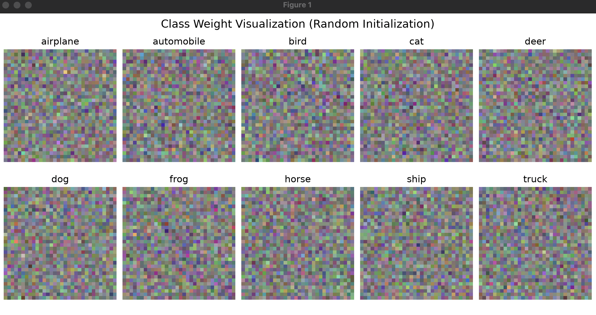
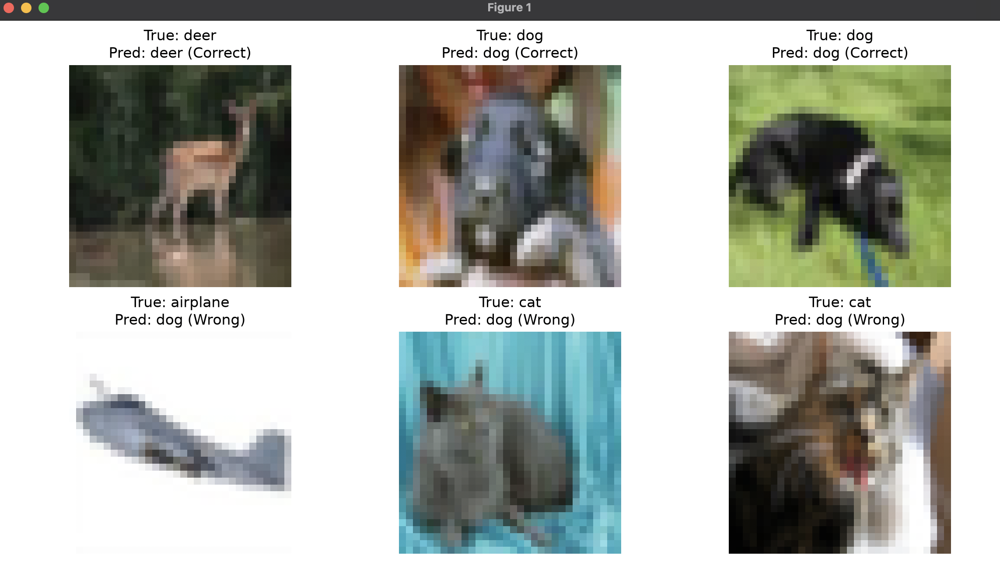

# CIFAR-10 Linear Classifier

## 1. Project Overview

CIFAR-10 데이터셋을 이용하여 무작위로 초기화한 가중치 기반의 선형 분류기를 구현하였다.

본 과제에서는 모델 학습을 수행하지 않고 클래스별 점수 계산, SVM Hinge Loss, Softmax를 확인하였다.

## 2. Dataset

- Dataset: CIFAR-10
- Number of classes: 10
- Image size: 32 x 32 x 3
- Input dimension: 3072

Dataset: https://www.cs.toronto.edu/~kriz/cifar-10-python.tar.gz

## 3. Implementation

- Random initialization of W
- Zero initialization of b
- Linear Classifier: f(x) = Wx + b
- Multiclass SVM Hinge Loss
- Softmax probability
- Class prediction
- Weight visualization

Note: No model training or weight updates were performed.

## 4. Results

### Class Weight Visualization

### Classification Examples

## 5. Conclusion

The experiment demonstrated how a linear classifier calculates class scores using randomly initialized weights.

Since no training was performed, the weight visualizations did not show meaningful class-specific features.
